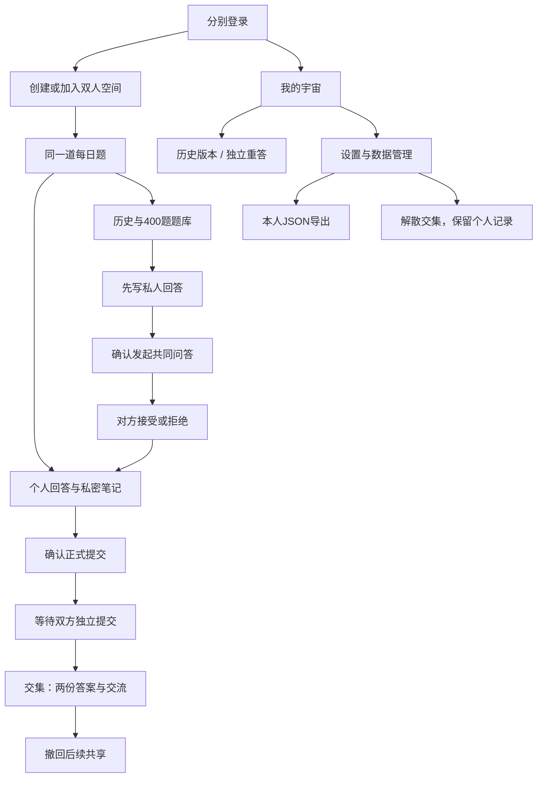
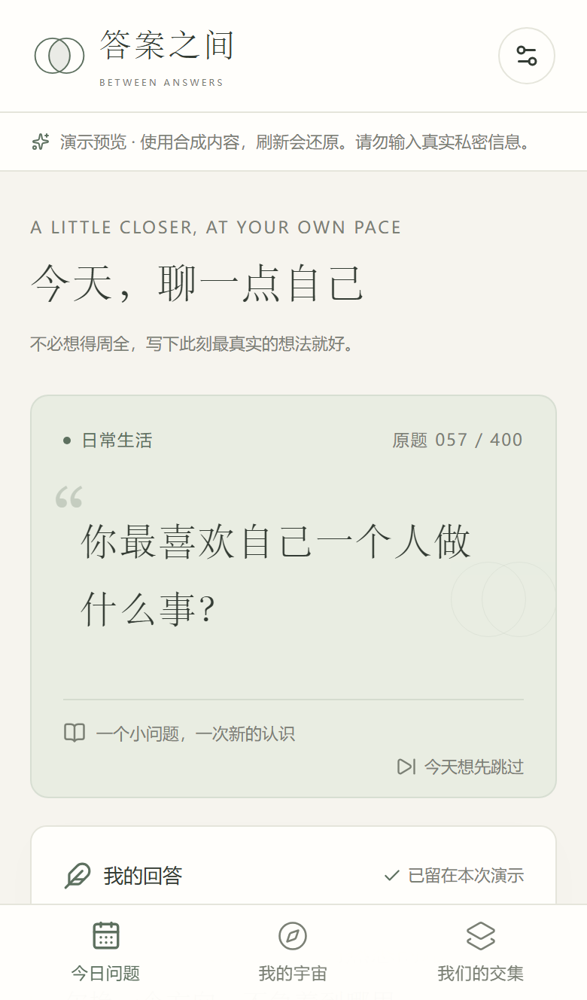
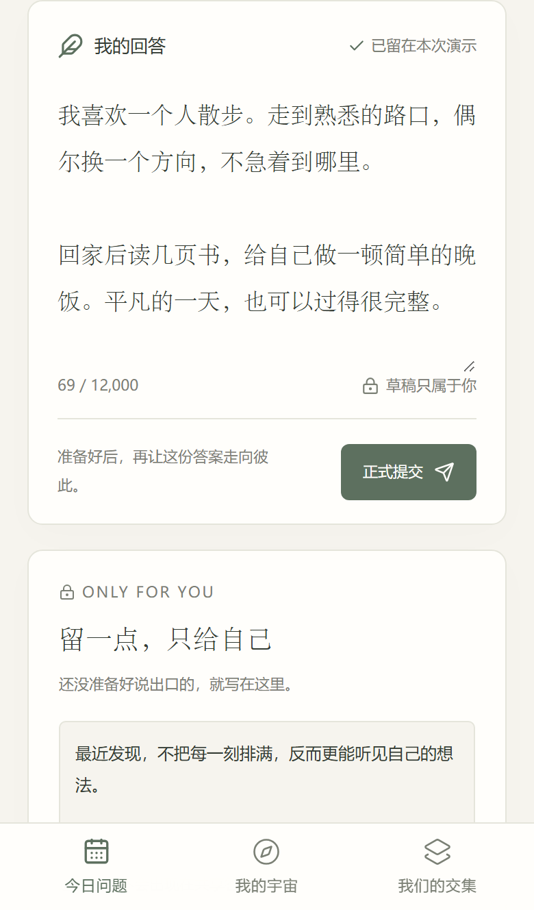
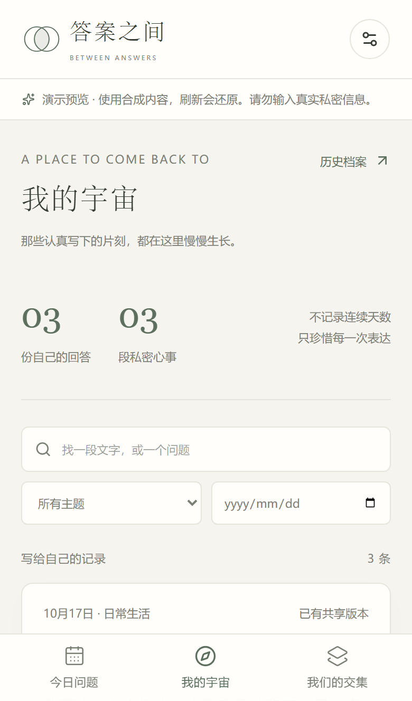
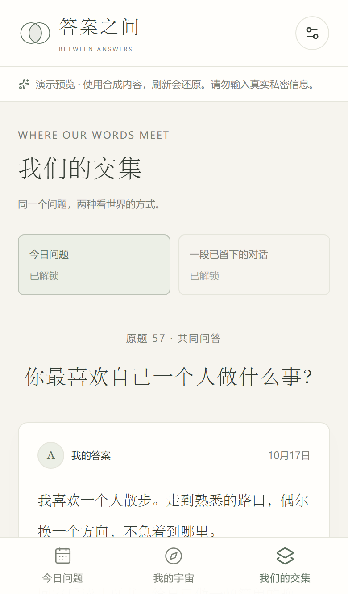
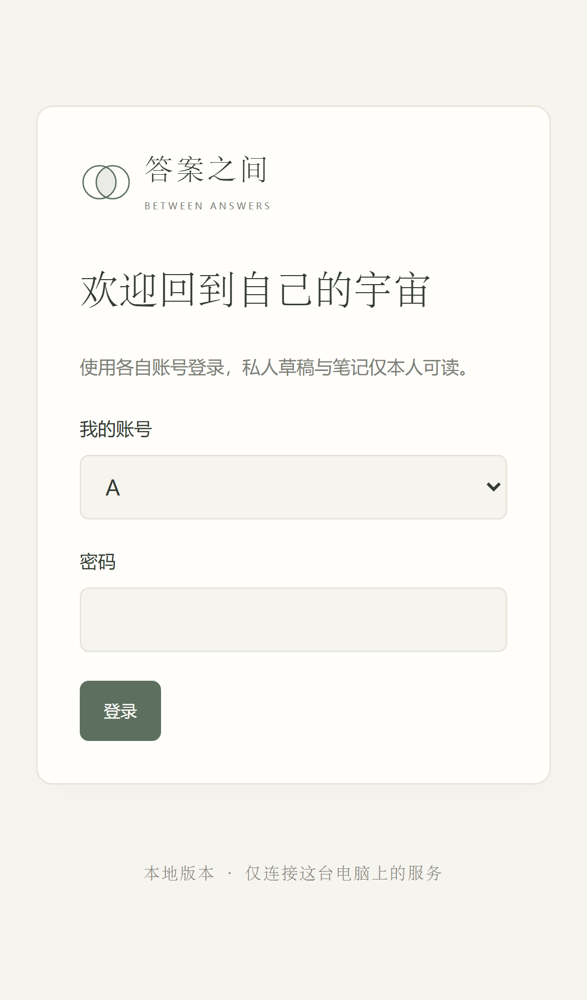
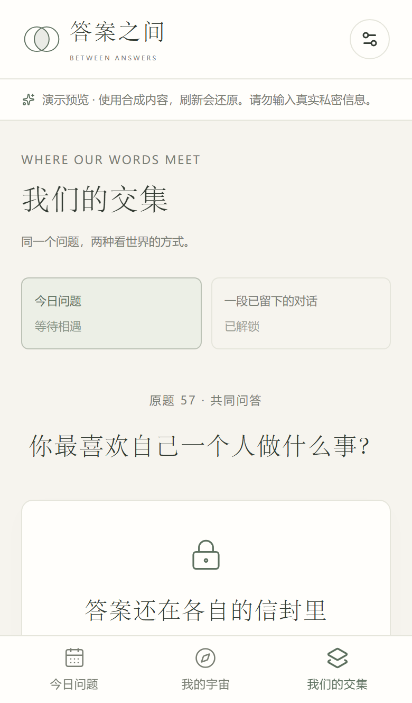

# 答案之间：产品设计交接版

版本：0.3.0-design。用户最新分工：本阶段交付产品、交互、可运行参考实现和资源；Work Buddy 使用已有域名与云数据库完成接入及发布。本文与实际页面、PRD 和代码共同构成设计依据。

## 产品与范围

两位朋友各自记录人生，也在答案之间认识彼此。个人记录和彼此交流同等重要；不默认恋爱、不计算契合度、不用连续打卡施压。跳过、晚答、撤回和结束共同空间都是正常选择。

V1 保持三个主入口：今日问题、我的宇宙、我们的交集。题库/历史和设置是次级入口。登录、绑定、历史版本属于具体流程，不增加底部栏目。游戏仅在 V2 开放，V1 不放空入口。

## 信息架构与流程

首次打开可先记录自己的答案，不以绑定、等待对方或每天完成为使用门槛。绑定只决定是否能开始共同题。

| 页面        | 首要内容与操作                                               | 设计约束                                               |
| ----------- | ------------------------------------------------------------ | ------------------------------------------------------ |
| 今日问题    | 原题、主题、原编号；答案编辑、私密笔记、保存状态、提交、跳过 | 私密笔记视觉上独立；正式提交需要确认                   |
| 我的宇宙    | 日期/主题/关键词筛选，个人回答与笔记，历史版本、重答、删除   | 自己的记录始终可管理；重答创建新记录                   |
| 我们的交集  | 轮次、共享状态、双方答案、留言与追问、撤回                   | 手机单列、桌面并列；锁定时不接收对方正文               |
| 历史与题库  | 按日期补答，搜索原题编号/正文、主题筛选、自由选题            | 400 原题保留；高敏感题可主动选择，非默认推送           |
| 设置        | 主题、账号、空间、导出、解散、注销                           | 实际使用不出现云平台、数据库密钥或网络探针配置         |
| 登录 / 绑定 | 各自身份、随机邀请码、待加入/已绑定状态                      | 不允许通过前端切换身份访问另一个人；切换视角只属于演示 |
| 历史版本    | 每次实际保存的答案、私密笔记与时间                           | 无权或失败不闪现正文；读取失败可重试                   |

## 交互状态

| 情况                    | 页面行为                                                              |
| ----------------------- | --------------------------------------------------------------------- |
| 首次加载 / 查询中       | 明确文字状态，尚未拿到授权内容不预填对方答案                          |
| 未绑定 / 等待成员       | 展示创建、邀请码或加入入口，仍可去宇宙和题库记录自己                  |
| 输入中 / 保存中         | 当前输入保留；只有服务端确认后才显示已保存                            |
| 保存失败                | 保留输入，允许重试、下载未同步副本；关闭页面前提示未保存              |
| 版本冲突                | 不自动覆盖，先保留副本，再确认读取新版本                              |
| 自己未提交 / 对方已提交 | 只提示进度，不显示对方正文，不催促                                    |
| 自己已提交 / 对方未提交 | 展示自己的固定版本与温和等待说明                                      |
| 双方已提交              | 服务端授权后展示两份答案，可以留言、追问、删除本人留言                |
| 自由题待接受            | 发起者与接收者均明确看见等待状态；高敏感题须确认愿意回答              |
| 撤回 / 拒绝 / 解散      | 关闭该轮后续读取；本人记录保留，可另起共同题                          |
| 会话失效                | 遮住对方内容并重新认证，保留当前答案输入                              |
| 进入后台 / 失联         | 隐藏对方正文，恢复后重新检查共享状态                                  |
| 无内容 / 无效链接       | 给出原因和返回入口，不把另一道题的答案填进错误链接                    |
| 日程跨过零点            | 固定正在编辑的题目；提示可打开今日题，由用户决定何时切换              |
| 推荐日程结束            | 说明日程走完，提供题库/补答入口，不把旧题冒充为新题，也不声称已经答完 |

从私人回答发起共同问答时，先保存原稿，再原子创建新轮次与个人草稿副本；原记录不移动。复制的笔记仍属于本人，不进入共享快照。邀请重试复用同一轮次 ID，不能重复创建。

留言发送时防重复点击，后续输入不被上一条的完成响应清空。当前对话不会因为另一轮刚解锁而自动换题。

## 视觉与移动体验

- 浅色：纸白 `#f6f4ee`、内容纸面 `#fffefb`、墨色 `#343c34`、鼠尾草绿 `#5d705f`。
- 深色：背景 `#1e2521`、纸面 `#252e28`、正文 `#e4e6dc`、强调色 `#adbea1`。
- 主要阅读使用系统宋体，操作使用系统中文无衬线；无外部字体或图标 CDN。问题、回答和私密笔记有不同层级与留白。
- 手机单列、底部三栏、安全区域留白；桌面左导航，正文限制阅读宽度。长文本保留段落，不将核心操作挤到图标里。
- 提供浅色、深色与跟随系统；可见键盘焦点，遵循减少动态效果偏好。没有恋爱图标、商业社交流、积分或连续天数惩罚。

## 页面预览

以下均为合成内容。手机图为真实视口或表单长页，桌面图可点击放大；没有真实用户答案或凭证。全部 19 张在 [design/](design/)。

| 今日问题                                 | 回答编辑                                   |
| ---------------------------------------- | ------------------------------------------ |
|  |  |

| 我的宇宙                                    | 我们的交集                            |
| ------------------------------------------- | ------------------------------------- |
|  |  |

| 登录                                 | 等待对方                                   |
| ------------------------------------ | ------------------------------------------ |
|  |  |

[桌面今日](design/desktop-today.png) · [桌面交集](design/desktop-shared.png) · [桌面档案](design/desktop-archive.png) · [深色设置](design/desktop-settings-dark.png) · [跨日状态](design/mobile-midnight.png)

## 后续设计边界

V2 的小游戏入口集中在独立“共同探索”页，只有双方已绑定时可进入，不占用 V1 的答题主路径。

| 功能       | 核心流程                                           | 隐私与退出                                               |
| ---------- | -------------------------------------------------- | -------------------------------------------------------- |
| 灵魂互换   | 选择题目 → 各自猜测 → 各自作答 → 双向揭晓          | 猜测与真实答案均独立解锁，不计算契合分数；可跳过         |
| 记忆拼图   | 从对方主动共享的内容出题 → 尝试回答 → 查看预设惊喜 | 不使用私密笔记；被撤回的来源不再出题                     |
| 时间胶囊   | 选择自己/对方 → 写信 → 确认日期 → 等待 → 解封      | 日期由服务端判断；寄出前可编辑，寄出后的撤回规则另行确认 |
| 阶段纪念册 | 主动发起回顾 → 预览允许使用的记录 → 选择导出       | 仅使用本人或仍获授权内容；不要求连续打卡                 |

个人重答已在 V1 实现；自动成长对比、PDF、媒体记录和自创题仍属后续，不伪装成已完成功能。
